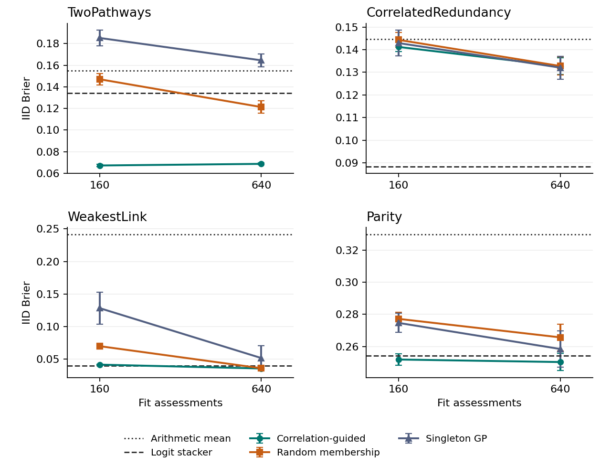

# Frozen transfer of the guided initializer

On a new conjunction task, WeakestLink, the anonymous correlation-guided initializer reached IID Brier **.04141** at 160 full fit calls, compared with **.12829** for native GP and **.06982** for the shape-matched shuffled initializer. The paired guided-minus-native difference was −.08688 (95% interval −.11180 to −.06197), with a lower loss in all 12 banks. By 640 calls the shuffled initializer had nearly caught up (.03585 vs .03549).

On Parity, the guided initializer also beat native GP early (.25185 vs .27463, difference −.02278, 95% interval −.02799 to −.01757). Its predicted probabilities remained about as accurate in Brier as a constant fitted class prevalence (.25063). The generator posterior achieved .01136. At 160 calls the guided trees classified 73.6% of test rows correctly, compared with 49.6% for the constant and 98.5% for the generator posterior. Threshold accuracy and probability quality capture different outcomes here.



The lines connect two measured budgets. Whiskers are 95% t intervals across independent bank means after averaging GP starts. Each panel has its own vertical scale. The first row summarizes the [original study](../guided/README.md); the second row contains these new transfer banks. The horizontal lines show baselines fitted once per bank or evaluated directly. [Plot source](figure.py)

## Four splits on new families

Lower positive-class Brier is better. Each method received the same anonymous provider columns. The stacker used only fit labels with fixed regularization, and the constant used only the empirical positive frequency on fit. The analytic reference knows the simulator and true provider assignments.

| Family | Method | Fit | Validation | IID | Shift |
|---|---|---:|---:|---:|---:|
| WeakestLink | Native GP, 160 | .11994 | .13213 | .12829 | .14085 |
| | Shuffled GP, 160 | .06754 | .07173 | .06982 | .09485 |
| | Guided GP, 160 | .03946 | .04368 | .04141 | .07801 |
| | Native GP, 640 | .04725 | .05330 | .05152 | .07229 |
| | Shuffled GP, 640 | .02963 | .03685 | .03585 | .05509 |
| | Guided GP, 640 | .02909 | .03573 | .03549 | .05617 |
| | Arithmetic mean | .24392 | .24379 | .24185 | .24332 |
| | Logit stacker | .03007 | .04178 | .03968 | .05482 |
| | Source prevalence | .05449 | .05929 | .05907 | .05717 |
| | Known posterior | .02115 | .02513 | .02249 | .03982 |
| Parity | Native GP, 160 | .25930 | .28006 | .27463 | .28617 |
| | Shuffled GP, 160 | .26783 | .29051 | .27714 | .28227 |
| | Guided GP, 160 | .24672 | .26461 | .25185 | .25015 |
| | Native GP, 640 | .24138 | .26492 | .25840 | .27250 |
| | Shuffled GP, 640 | .25523 | .27803 | .26563 | .27045 |
| | Guided GP, 640 | .24406 | .26228 | .25028 | .25159 |
| | Arithmetic mean | .32555 | .34140 | .32980 | .27981 |
| | Logit stacker | .24610 | .25399 | .25407 | .25136 |
| | Source prevalence | .24948 | .25036 | .25063 | .25063 |
| | Known posterior | .00981 | .01000 | .01136 | .11493 |

WeakestLink is positive when all four independent conditions hold. Its population prevalence is 1/16, and each condition has two providers. At 160 calls the guided policy beat the fitted prevalence by .01767 IID Brier (95% interval .01597–.01936), but the stacker still had a small advantage of .00173 (.00039–.00306). At 640 calls guided GP beat the stacker by .00419 (.00261–.00577) on IID, while their shifted difference included zero. The detector accuracy shift from .85 to .76 reduced the benefit of this probability rule.

Parity is positive when exactly one of two latent conditions holds. Three providers observe each condition. The scoped library of positive group averages, minima and maxima is monotone; increasing a factor cannot decrease its output. XOR requires both directions. Native GP can also draw nonmonotone threshold operators. Its modest finite-budget result does not imply an impossibility for every GP program. Relative to source prevalence, early guided GP's IID difference was +.00122 (−.00254 to +.00498). Weaker detector accuracy (.92 to .78) reduced available evidence, reflected in the oracle's larger shifted Brier.

## Budget and replication

Both families used 12 new banks (28100–28111), two GP starts per bank, 384 fit rows and 256 separate validation rows. Each test domain had 4,096 cases. Both template arms paid for all 135 initial templates, with ordinary GP scoring afterward, and every arm deployed its best fit candidate at precisely 160 and 640 assessments. Validation measured these frozen candidates and chose none. Both primary contrasts were specified before scoring; all trees were frozen before evaluating validation or test outcomes. At 160 calls mean fit time for guided versus native was 29 vs 64 ms on WeakestLink and 25 vs 55 ms on Parity. At 640 these means were 145 vs 221 ms and 131 vs 287 ms. Shared-CPU timings include fit I/O, search and proposal cost. See per-bank results for inference time, node counts, seed variance and comparator timing.

The transfer evaluation used the full-library OKAPI implementation from `2f6ff1d` and the same FusionBench commit `4cf4810` as the original. The driver adds explicit family selection and preserves original default runs. The two additional references were fixed before reading transfer scores and do not enter model selection. Separate replay of both families, both optimizer starts and two banks reproduced 288 rows exactly on all 20 non-timing fields.

```sh
export PYTHONPATH="$PWD:$FUSIONBENCH" OPENBLAS_NUM_THREADS=1 OMP_NUM_THREADS=1 MKL_NUM_THREADS=1 OKAPI_LOG_LEVEL=ERROR
python experiments/guided/run.py --families weakest_link parity --banks $(seq 28100 28111) --out /tmp/guided-transfer
python -m experiments.guided_transfer.references --out /tmp/guided-transfer/references.csv
```

[Protocol](protocol.md) · [Run measurements](results/runs.csv) · [Paired estimates and seed variation](results/paired.csv) · [Independent reference rows](results/references.csv) · [Reference driver](references.py)
