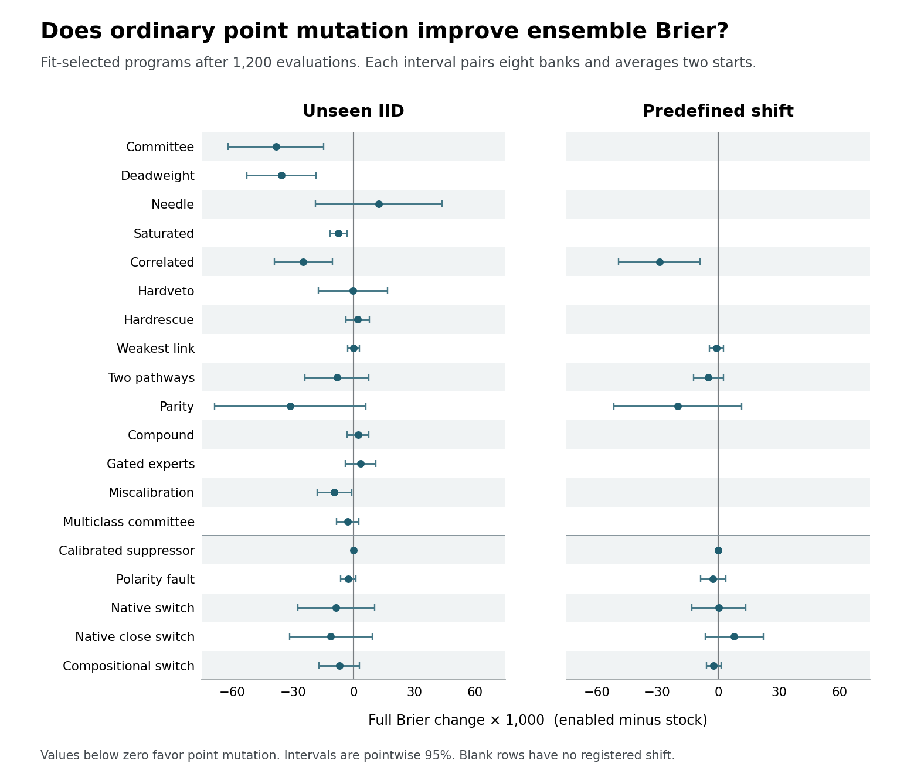

# Multiclass and native-loop checks for the standard point-mutation sweep

## Nineteen-scenario regression screen

After 1,200 native training evaluations, point mutation reduced the equally weighted mean full Brier from **.26839 to .25947** across the 19 canonical cases. Mean, fit-ranked Top-N and regularized logistic stacking scored .37818, .33418 and .22874. Fifteen point estimates favored the switch. The individual 95% intervals were wholly below zero on Committee, Correlated, DeadWeight, Miscalibration and Saturated. None was wholly above zero. Among nine predefined shifts, the interval for Correlated was below zero, −.02912 [−.04924, −.00901]. These intervals use eight data banks per scenario. The largest point-estimated IID regression was Needle (+.01239); its interval crossed zero. No particular optimum was established for the full suite. The earlier planted-tree trial separately established representability and a remaining search gap. [Full result, selection, cost and verification of 729,600 native training assessments](https://github.com/damiankucharski/FusionBench/blob/d4c4bd199f3f783b26efe9be9d4c757b75faac45/docs/ensemble-study/full-suite-point/README.md) · [Controlled attainable tree](../organic_fates/README.md)



The top 14 rows are the main-branch scenarios, followed by the five research additions. For each scenario we independently recomputed the two-start mean difference within each bank and its pointwise two-sided t interval from the raw runs, then checked every plotted value against the published paired contrasts to absolute tolerance 2e−15. The figure uses the same scale in both panels. [Reproduction script](figure.py) · [Source rows and paired tables](https://github.com/damiankucharski/FusionBench/tree/d4c4bd199f3f783b26efe9be9d4c757b75faac45/docs/ensemble-study/full-suite-point)

## Technical controls

The complete FusionBench registry at d00e1a8 has 19 default scenarios: 17 binary, Saturated with four classes and MulticlassCommittee with five. We checked geometry and simplex mass on outputs from every registered generator. A separate independent interpreter checked all six operator families at root and nested sites, including disjoint supports where a componentwise minimum has zero mass. The native multiclass postprocessor maps a zero row to the uniform distribution and normalizes each other row immediately after every operation. Applying a single final normalization computes a different function on the nested witness. The native fitness equals one minus half of the full class-summed Brier loss. A binary positive-channel Brier is half the reported two-class sum.

A 100-generation fixture on three stock generators verified that point replacement was actually executed when enabled and absent when disabled and that every final survivor's off-training predictions matched the independent evaluator. A separate replay used the exact public OKAPIMethod options and shallow seeding with its ordinary native engine. Across committee, saturated and multiclass_committee, a manual three-generation run_iteration loop matched public adapter training on every scored program in order, raw fitness arrays, final population and RNG state. These are deterministic integration checks on fixed small datasets. The independent campaign measures performance and regression under its larger, prospectively fixed scope. [23 executable checks](verify_multiclass.py) · [Registered full-suite protocol](https://github.com/damiankucharski/FusionBench/blob/7de5e8e63ab8eb18dad4ad62b6cf222b1d2b1b10/docs/ensemble-study/full-suite-point/protocol.md)

## A cross-task prediction bug at the benchmark pin

In FusionBench d00e1a8, training the multiclass model after a six-node binary committee model changed every one of the binary model's 192 previously scored predictions. The maximum class-probability change was .92349, and full Brier rose from .28049 to 1.08333. Restoring the binary identity postprocessor reproduced every original probability exactly. Both models used the same standard adapter with fixed seeds. The adapter sets the global native postprocessor during fitting; later prediction reads whichever setting is active. A shared process retaining binary and multiclass models needs to scope each prediction to its original task. The paired audit above sets the proper function for each model before comparing it. [Reproducer using two actual fitted models](postprocessing_witness.py)

The native lab branch exposes a scoped postprocessor for applications with multiple trained models. Use the prediction function associated with the saved task at the point where the tree executes. Nested scopes, exceptions, threads and asynchronous tasks are covered by regression tests. Unscoped calls still use the established global setting. This isolates the postprocessing function; each caller must manage its own mutable prediction tree and backend. The benchmark reproducer confirms that switching just this function locally restores all 192 binary rows while leaving the outer setting available to the multiclass model. [Scoped OKAPI API](../../okapi/globals.py) · [Concurrency and exception tests](../../test/test_postprocessing_scope.py)

```python
from okapi.globals import use_postprocessing_function

with use_postprocessing_function(model_postprocessor):
    predictions = tree.do_pred_on_another_tensors(current_tensors=query_tensors)
```


The public FusionBench adapter at 03fd9bb now enters the task's postprocessing scope on prediction. Repeating the original committee/multiclass sequence with ordinary predict calls produced zero changed rows, zero maximum probability difference, and the same full Brier of .28049033 before and after training the second model. [Public adapter fix](https://github.com/damiankucharski/FusionBench/commit/03fd9bb) · [Audit of earlier OKAPI experiments](historical_impact.md)
