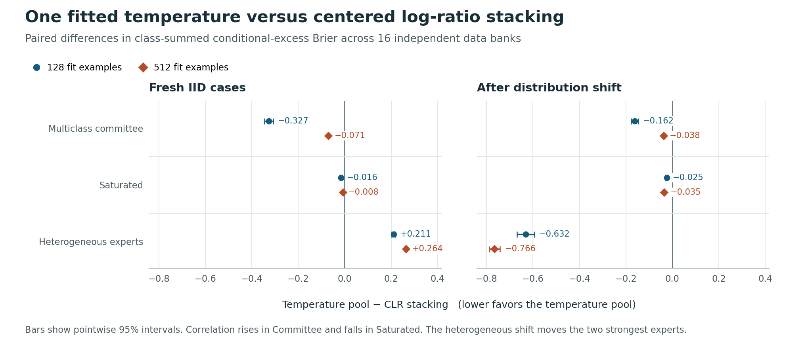

# When one fitted temperature is enough for multiclass fusion

On two Gaussian scenarios with equally informative experts, a single fit-only temperature learned useful multiclass probabilities from 128 labels. Its **IID conditional-excess Brier was .17167 lower** than regularized centered log-ratio stacking (95% paired interval .16249 to .18086). With 512 fit rows the gap narrowed to .03920 [.03676, .04165]. On the deliberately heterogeneous source, allowing each provider a different influence reversed the result. The common temperature lost to the same stacker by .21073 [.20306, .21841] at 128 labels and .26413 [.25900, .26927] at 512. Each estimate uses 16 independent banks. [Frozen protocol](protocol.md) · [Paired differences and uncertainty](results/paired.csv)



## Held-out probability quality

Values below are full class-summed Brier against independent **observed labels**, lower is better. Every trained method saw the same fit rows and anonymous provider columns. The GP entry averages the two independently seeded six-operator trajectories in each bank. Fixed T=1 uses a geometric pool with normalization. Random T uses the identical supplied tree and as many complete fit likelihood evaluations as the deterministic fitter's likelihood and derivative passes combined. [All four splits, both GP starts and prediction digests](results/scores.csv.gz) · [Per-method means and intervals](results/means.csv)

| IID source | Fit rows | All mean | Top-N | Logit stack | CLR stack | Stock GP, 600 calls | T=1 | Random T | Fitted T |
|---|---:|---:|---:|---:|---:|---:|---:|---:|---:|
| MulticlassCommittee | 128 | .70514 | .71719 | .93308 | .92926 | .72205 | .68733 | .60248 | **.59982** |
| MulticlassCommittee | 512 | .70514 | .70839 | .68856 | .67061 | .71005 | .68733 | .60163 | **.59940** |
| Saturated | 128 | .19879 | .20080 | .15455 | .15416 | .18184 | .19670 | .13748 | **.13738** |
| Saturated | 512 | .19879 | .20000 | .14488 | .14447 | .18073 | .19670 | .13681 | **.13639** |
| Heterogeneous | 128 | .60911 | .24487 | **.14817** | .15536 | .16063 | .60324 | .36823 | .36701 |
| Heterogeneous | 512 | .60911 | .24487 | .10118 | **.10085** | .15591 | .60324 | .36717 | .36634 |

On the two exchangeable sources at 128 labels, CLR beat the scalar by .18554 Brier **on training labels**, but the scalar won by .17311 **on unseen labels**. On those same fit inputs the scalar was already .12115 closer to the known true probabilities by squared distance. CLR is expressive enough to represent the correct source laws. Here stronger structural restriction protected the fit against label noise. Both public stackers used fixed C=1, so this study does not establish a comparison against optimally tuned regularization. On the heterogeneous source, knowing which two providers were competent mattered more. Top-N chose two on every fit.

## What the source shift changes

Increasing MulticlassCommittee correlation from 0 to .55 preserves each provider's marginal quality while greatly reducing the independent information in the pool. With 128 fit rows, the frozen temperature then scored **.96665**, worse than the all-provider mean **.76565** and unit-temperature log pool .76951. Its IID conditional excess .00077 rose to .20620. The stock GP shifted Brier was .78808, Top-N .77148 and logit stacking 1.13274. On Saturated the correlation fell from .95 to .35 and the frozen temperature retained the best point estimate, .02829 versus .15756 mean, .17966 Top-N, .04996 logit stacking and .08546 stock GP.

Moving the two strong providers in the third family reverses the advantage of provider-specific weights. At 512 fit rows the frozen scalar gave .36625 shifted Brier versus 1.13216 for CLR, 1.10599 for logit stacking and .83806 for Top-N. All these are constructed shifts with known parameter changes. The experiment includes no separate real dataset or deployment-time adaptation. [All domain-specific contrasts](results/paired.csv)

## Representation and search cost

The original `LogitMeanNode` implements the class-normalized geometric pool. Its `temperature` multiplies mean log probabilities. In the first two source generators its analytically indicated values are 3.16847 and 2.54916. Across 16 banks the temperatures fitted at 512 labels averaged 3.1481 and 2.6076. Ordinary stock GP excludes this optional operator. The weak stock result therefore does not measure the ability of an expanded GP grammar to discover the logarithmic tree and fit it unaided. This study supplies the all-provider structure and learns its one coefficient from labels.

The deterministic solver achieved a lower training NLL than the cost-matched random scalar search in **96 of 96** cells. The median fit-NLL improvement was .00069 per row. On the exchangeable IID primary panel the additional conditional-excess reduction over random T was only .00146 [−.00025, .00316]. The much larger gain over fixed T=1 was .07265 [.07197, .07333]. Most of the observed IID advantage in this comparison came from the family of fitted scalar predictors. The solver's sample objective is convex on the registered training interval.

The solver averaged 13.04 complete likelihood or derivative assessments and 1.24 ms CPU per fit. The random alternative used the same 13.04 assessments and averaged 3.36 ms. Ordinary GP used 600 training assessments per start and 345.29 archive validation assessments on average, with 374.01 ms CPU. In total the 192 GP starts used 115,200 full fit and 66,295 validation assessments. The GP champion was selected only by fit Brier. A logged validation audit used 256 separate labeled rows and did not influence it. There were no validation evaluations for selection by the other methods. Timings are from this one CPU-threaded implementation under shared machine load. [Every fit, evaluation count, timing and selected N/T](results/budgets.csv.gz) · [Mean costs](results/costs.csv)

## Deployment function and verification

The public fitting entry point takes ordinary class-aligned probability matrices and integer class labels. It returns the native tree and its fitted scalar, NLL and cost. [Source](../../okapi/temperature.py) · [Twenty API, optimum and backend tests](../../test/test_temperature.py)

```python
from okapi.temperature import fit_multiclass_temperature_tree

fit = fit_multiclass_temperature_tree(fit_predictions_by_provider, fit_labels)
probabilities = fit.predict(new_predictions_by_provider)
```

An independent bounded minimizer reproduced the minimum NLL within 4.45×10⁻¹⁶ in all 96 cells. Replaying the stored unit, fitted and random temperatures reproduced all **1,152** prediction matrices bit-for-bit and their reported metrics within 2.45×10⁻¹⁵. On 286,720 generated exchangeable rows the known analytic temperatures matched the correct posterior within 3.99×10⁻¹³. The native output clamp activated on 99 of those rows. An explicit tail example produces the same native probability .00135 for two inputs with true probabilities .01539 and .79997. Agreement on natural samples therefore has a precise boundary in the unbounded Gaussian support. [Independent verifier and tail construction](verify_results.py) · [Verification counts](results/verified.json) · [Historical oracle correction](https://github.com/damiankucharski/FusionBench/blob/68f697b/docs/ensemble-study/multiclass-oracle/README.md)

Run `python -m experiments.temperature_pool.run --out /tmp/temperature-pool` with the pinned FusionBench checkout on `PYTHONPATH`. The runner emits `scores.csv` and `budgets.csv`. Compress each with `gzip -n`, then run `python -m experiments.temperature_pool.summarize /tmp/temperature-pool` and `python -m experiments.temperature_pool.verify_results /tmp/temperature-pool`. A separate reconstruction on all three families at bank 61200 and 128 fit rows reproduced 3/3 native GP trajectories (1,800 evaluations), 12/12 GP prediction matrices, 48/48 prediction matrices from the four public baselines and all three Top-N rankings and lengths. The archived evidence was produced by [the frozen runner](https://github.com/damiankucharski/OKAPI/tree/5e35b37b1b6eef524d3620aae039b3c45fa99c8d/experiments/temperature_pool). The postprocessing script explicitly filters scalar controls before pivoting the one-row-per-fit cost table because ordinary GP has two rows per bank. This summary-only correction did not alter the observations or preregistered outcome.

Guo et al. evaluated calibration of a single classifier by fitting one temperature to held-out logits. The multiclass pool experiment, case-specific proof, heterogeneous control, fitted OKAPI API and measured shifts here are the current project's work. [Guo et al., ICML 2017](https://proceedings.mlr.press/v70/guo17a.html) · [Central literature entry and scope](https://github.com/damiankucharski/FusionBench/blob/37f890b/docs/ensemble-study/literature/README.md)
